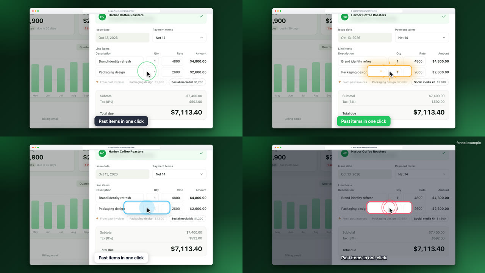
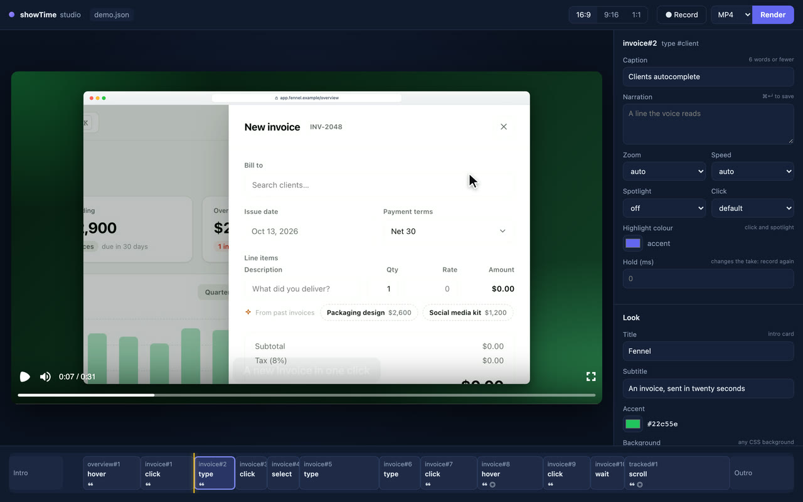
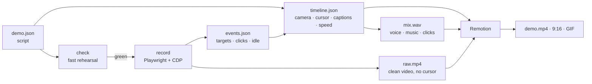

<div align="center">


# showTime

**Product demos, directed by AI.**

Your AI agent (Claude Code or Codex) writes a short JSON script. showTime clicks through your web app, films it and edits it
the way a motion designer would (auto-zoom, a smooth cursor, click ripples, spotlights, captions,
sped-up loading, narration) and hands you a polished video: a 1080p MP4, a 9:16 cut for social or
a GIF for your README.<br />
No re-take when a caption changes, and a studio for when you want to fine-tune by hand.

[](https://github.com/mineo71/showTime/actions/workflows/ci.yml)
[](https://www.npmjs.com/package/@mineo71/showtime)
[](LICENSE)


**[Install](#install)** · [Try it](#try-it) · [Use with Claude Code or Codex](#use-it-with-claude-code-or-codex) · [Studio](#studio) · [Script reference](#script-reference) · [CLI](#cli)

</div>

<div align="center">
  <a href="docs/media/demo.mp4"></a>
  <br />
  <sub>Made by <a href="examples/fennel/demo.json">a 39-line script</a>, a <a href="examples/fennel/showtime.config.json">brand file</a> and one command, with no manual editing. <a href="docs/media/demo.mp4">▶ Full-quality MP4, with sound</a></sub>
</div>

---

## Install

Needs **Node ≥ 20** and **ffmpeg** (`brew install ffmpeg` / `sudo apt install ffmpeg`).

```bash
npm install -g @mineo71/showtime
showtime setup      # downloads Chromium + the renderer, links the skill into Claude Code and Codex
showtime --help     # check that it works
```

Then ask your agent for a demo, or [film the bundled example](#try-it).

**Or let your agent install it.** Paste this into Claude Code or Codex:

> Install showTime: run `npm install -g @mineo71/showtime`, then `showtime setup`, and check
> that `showtime --help` works.

<sub>**Update:** `npm install -g @mineo71/showtime@latest`. **Switched Node versions with nvm?** Install it again under the new version. **From source:** clone the repo, then `npm install && npm link && showtime setup` (see [CONTRIBUTING](CONTRIBUTING.md)).</sub>

## Why

Every pitch, launch post and README needs a product demo. Recording one is the easy part. The
editing eats the afternoon: zooming in on the button that matters, smoothing a jittery mouse,
cutting the spinner, adding captions, and doing it all again when the UI changes next week.

An AI can already write the shot list. **showTime gives it hands and an editing suite.** Claude
explores your app, writes the script, rehearses it, records it and reviews the stills. You watch
the result and ask for changes in plain words.

## From script to screen

A step in the script says *what happens* and *what the viewer should notice*:

```json
{ "do": "hover", "target": ".bar[data-m='Oct']", "show": { "caption": "Your studio at a glance" } }
```

showTime records the app untouched, then builds everything else from what happened during the take:

<table>
  <tr>
    <th width="50%">What the browser recorded</th>
    <th width="50%">What showTime rendered</th>
  </tr>
  <tr>
    <td></td>
    <td></td>
  </tr>
</table>

The window, the camera move, the cursor and the caption are all added **after** the recording.
Change a caption, the colours or the pacing and re-render in seconds, without touching the app
again.

## Features

<table>
  <tr>
    <td width="50%" valign="top">
      <br />
      <b>🔍 Auto-zoom that follows the action</b><br />
      <sub>The camera eases in on every click and keystroke. Zoom depth comes from the target's size, and nearby moments are joined by a pan instead of a bounce.</sub>
    </td>
    <td width="50%" valign="top">
      <br />
      <b>⌨️ Human typing, smooth cursor</b><br />
      <sub>A synthetic cursor glides along eased paths, turns into an I-beam over text fields and types at a natural (seeded, repeatable) pace.</sub>
    </td>
  </tr>
  <tr>
    <td valign="top">
      <br />
      <b>🔦 Spotlights and captions</b><br />
      <sub>Dim everything except the number that matters. One-line captions carry the story and fade in sync with the action.</sub>
    </td>
    <td valign="top">
      <br />
      <b>⏩ Loading, compressed</b><br />
      <sub>Spinners and network waits are detected and sped up 2–8×, so the demo never stalls. Click ripples show every press.</sub>
    </td>
  </tr>
  <tr>
    <td valign="top">
      <br />
      <b>🙈 Privacy masks</b><br />
      <sub>Blur emails, names or card numbers with plain CSS selectors. The blur is applied inside the browser, so no frame ever holds the real data.</sub>
    </td>
    <td valign="top">
      <br />
      <b>🎬 Intro card and window chrome</b><br />
      <sub>Title card with your logo, a browser frame with your URL, a gradient backdrop, rounded corners and a shadow. Each of them is a <code>style</code> or <code>meta</code> field.</sub>
    </td>
  </tr>
  <tr>
    <td valign="top">
<pre lang="json">
"show": { "say": "Send it before lunch." }

"audio": {
  "voice": { "engine": "openai", "name": "nova" },
  "music": { "file": "bed.mp3" },
  "sounds": true,
  "subtitles": "burn"
}
</pre>
      <b>🎙️ Narration, music and clicks</b><br />
      <sub>Give a step a line and a voice reads it: the built-in voice of macOS or Linux, OpenAI, ElevenLabs or any TTS command. The video holds the frame until the line ends, music ducks under the voice, and subtitles come as an <code>.srt</code> or burned in.</sub>
    </td>
    <td valign="top">
      <br />
      <b>📱 Every format from one take</b><br />
      <sub><code>--aspect 9:16</code> or <code>1:1</code> crops the window and a follow camera keeps the action in view. <code>--format gif</code> or <code>webp</code> for READMEs and docs. Nothing is re-recorded.</sub>
    </td>
  </tr>
  <tr>
    <td valign="top">
      <br />
      <b>🎨 Your look</b><br />
      <sub>Four click animations (or none), a highlight colour per step, dim, ring or glow spotlights, five caption styles, your own fonts (embedded in the video) and a watermark. All of it re-renders without a new take.</sub>
    </td>
    <td valign="top">
<pre lang="json">
"audio": { "sounds": "mechanical" }

"show": {
  "say": "And over to Daniel.",
  "voice": { "name": "Daniel" }
}
</pre>
<pre>showtime voices --lang uk
showtime voices --try "Привіт" --voice Lesya</pre>
      <b>🔊 Sound packs and voices</b><br />
      <sub>Soft, mechanical, pop, tap or typewriter clicks (or your own files), a different voice for any line, and a command to list and try the voices you have.</sub>
    </td>
  </tr>
  <tr>
    <td valign="top">
      <br />
      <b>📣 Ends on your call to action</b><br />
      <sub>An outro card with your logo, a headline and the URL to visit. Put it in a brand file once and every demo ends the same way.</sub>
    </td>
    <td valign="top">
      <br />
      <b>🧪 Reviews its own work</b><br />
      <sub><code>showtime frames</code> renders a contact sheet of every step, and <code>showtime lint</code> flags captions that are too long or too brief to read. The agent fixes them before you look.</sub>
    </td>
  </tr>
</table>

And under the hood:

- 🔎 **Knows the page before writing.** `showtime inspect <url>` lists every button, link and field
  with a ready target (and how many elements it matches) plus a screenshot.
- ✅ **Rehearsal mode.** `showtime check` runs the script at full speed and screenshots every step.
  When a step fails it prints an ARIA snapshot of the page, so Claude can fix its own selectors.
  `--until scene#n` stops before an expensive part, such as a burst of paid AI calls.
- 🚀 **Starts your app.** `server` runs your dev command, waits until the app answers, and stops it
  after the take; a server that is already running is reused.
- 🔁 **Stale-take detection.** The take stores a hash of the actions. Edit a caption and `render`
  reuses the take. Edit a click and `render` tells you to `record` again.
- 🧹 **Clean state for every take.** `hooks` run a reset command or call an endpoint before and
  after each rehearsal and take, so a flow that creates data works twice in a row.
- 🎭 **Deterministic pages.** `app.mock` answers flaky or slow APIs with canned JSON, `app.clock`
  pins the date, and `app.dialogs` answers `confirm()` the way the demo needs. `app.hide` removes
  dev badges and chat widgets; `app.reducedMotion` shows scroll-reveal sections at once.
- 📼 **Pay for an API once.** `replay` records the answers of the calls you name (HTTP and
  WebSockets) on the first run and serves them back after that: rehearsals and takes stop spending
  quota, work offline and come out the same every time.
- 🌍 **One script, many languages.** List `locales`, write any value as `{ "en": …, "uk": … }`, and
  `make --locales all` films `demo.en.mp4`, `demo.uk.mp4`, … each with its own captions, voice,
  URLs and targets.
- 🎨 **One brand file.** `showtime.config.json` holds your colours, logo and outro; every script
  below it inherits them.
- 🛟 **Safe re-takes.** A take that fails halfway leaves the last good one untouched.
- 🤖 **JSON everywhere.** Every command takes `--json`, so agents read results instead of parsing
  prose. Captions stay up long enough to read and move to the top when the action happens at the
  bottom of the screen.
- 📐 **Typed scripts.** Point `"$schema"` at [`docs/script.schema.json`](docs/script.schema.json)
  for autocomplete and validation in your editor.
- 🖥️ **Crisp at 1080p.** The app is captured at 2× device scale, so zoomed shots stay sharp.

## Try it

After [installing](#install), film the example app from the video above. The example lives in
the repo:

```bash
git clone https://github.com/mineo71/showTime.git && cd showTime
npm run example                              # terminal 1: serves examples/ on http://127.0.0.1:4800
showtime make examples/fennel/demo.json      # terminal 2: → examples/fennel/demo.mp4
```

`make` rehearses the script, records it in real time (about 25 s for this one) and renders it.
Expect a minute or two end to end.

## Use it with Claude Code or Codex

`showtime setup` links the skill into `~/.claude/skills` for Claude Code and `~/.agents/skills`
for Codex (`--agent claude` or `--agent codex` picks one). Then ask for a demo the way you would
ask a person:

> Make a 30-second demo of the checkout flow on localhost:3000 for our investor deck.
> Blur customer emails.

The agent takes it from there:

1. **Explores** the app with `showtime inspect` (or the Playwright MCP) and picks the 2–4 moments
   that sell it.
2. **Writes** `demo/checkout.json`.
3. **Rehearses** with `showtime check` until every step passes, fixing selectors from the ARIA
   snapshot.
4. **Records and renders** with `showtime record` and `showtime render`.
5. **Reviews** the contact sheet from `showtime frames` and the warnings from `showtime lint`,
   tightens captions and pacing, and re-renders.

The skill ([`skill/SKILL.md`](skill/SKILL.md)) is a plain-Markdown
[Agent Skill](https://agentskills.io). Any agent that can run shell commands can follow it, and so
can a human with a text editor.

## Studio

The agent writes the script; you polish it. `showtime studio demo/pitch.json` opens a local page
with the edited video playing, a timeline of the steps and an inspector:



- Pick a step and change its caption, narration line, zoom, spotlight or speed; the preview updates
  in about a second and the change is saved to the JSON. The studio writes the file with one step
  per line, so the first save may reformat it; after that each edit is a one-line diff.
- Drag a step's right edge on the timeline to speed it up or slow it down (0.25–16×; a step held
  for a narration line can't get shorter than the line), and a caption's right edge to keep it up
  longer or shorter. A freeze (a still frame at the end of a
  step) is set in the inspector and shows striped on the timeline. None of these need a new take.
- Switch the preview between 16:9, 9:16 and 1:1, and render MP4, GIF or WebP from the page.
- The page reloads on its own when the file changes on disk, so you can keep it open while your
  agent edits the script.
- It only listens on `127.0.0.1`. Changes need a token that only its own page has, and the page
  can't be framed by another site.

**Rather show the flow than describe it?** `showtime record-human http://localhost:3000 -o demo/flow.json`
opens a browser. Click through the flow and close the window: you get a script of those steps with
readable selectors, ready for captions and `showtime make`. Double, right and modifier clicks, file
picks (check the file paths: the recorder only knows their names) and popups come along.

## How it works



The core idea is to **separate capture from direction**. `record` drives a real Chromium through
the script and writes two things: a clean video with no cursor, and an event log of where every
target was, when each click landed and when the page sat idle. A pure function,
`buildTimeline(script, events)`, turns that log into speed segments, camera keyframes, cursor
paths, captions and spotlights, and holds the frame wherever a narration line needs more time.
The soundtrack is mixed from the same timeline, and Remotion renders the result frame by frame.

So presentation is cheap to change and recording stays honest: the app really is clicked, typed
into and waited on, and everything cinematic is computed afterwards.

## Script reference

```json
{
  "$schema": "https://raw.githubusercontent.com/mineo71/showTime/main/docs/script.schema.json",
  "version": 1,
  "meta": { "title": "Acme", "subtitle": "Reports in two clicks" },
  "app": { "url": "http://localhost:3000/", "mask": [".email"] },
  "setup": [{ "do": "click", "target": "text=Accept cookies" }],
  "style": { "accent": "#6366f1" },
  "scenes": [
    {
      "id": "report",
      "steps": [
        { "do": "click", "target": "role=button[name='New report']", "show": { "caption": "A report in one click" } },
        { "do": "type", "target": "#name", "text": "Q3 revenue" },
        { "do": "click", "target": "text=Create" },
        { "do": "wait", "for": "text=Report ready" },
        { "do": "hover", "target": ".total", "show": { "spotlight": true, "hold": 1500 } }
      ]
    }
  ]
}
```

`meta.title` adds an intro card, `meta.outro` a closing card and `meta.logo` puts your logo on
both. `setup` steps run before the camera starts (cookie banners, onboarding). Scenes group steps
for readability and for naming the stills.

<details>
<summary><b>Actions</b> (<code>do</code>)</summary>

| action   | fields                          | notes |
|----------|---------------------------------|-------|
| `goto`   | `url`                           | navigate and wait for `load` |
| `click`  | `target, button?, modifiers?`   | cursor travels there, ripple on press; `button`: `right` (context menus) or `middle`; `modifiers`: `["Shift"]`, `["ControlOrMeta"]`, … held during the click |
| `dblclick` | `target, modifiers?`          | double click, drawn as two clicks |
| `drag`   | `target`, `to` *or* `by`        | press on the target, carry it to `to` (a selector) or `by: { x, y }` px, release; HTML5 drag and drop and pointer-driven sliders and boards both work; both ends must be on screen |
| `upload` | `target, files`                 | click what a person clicks to pick files (button, drop zone) and choose `files` (relative to the script); a hidden `<input type=file>` is filled directly |
| `type`   | `target, text, pace?, clear?`   | `pace`: `human` (default), `fast` or ms per character |
| `press`  | `key`                           | `Enter`, `Escape`, `Meta+K`, … (combos show as keycaps, see `style.keys`) |
| `closeTab` |                               | close the tab or popup a step opened and go back to the page before it |
| `hover`  | `target`                        | |
| `select` | `target, value`                 | picks a `<select>` option by value |
| `scroll` | `target` *or* `by`              | smooth-scroll an element into view, or by pixels |
| `wait`   | `for` *or* `ms`, `timeoutMs?`   | prefer `for` (a selector): the wait is sped up automatically; `timeoutMs` (default 15 s, up to 300 s) for slow backends |
| `pause`  | `ms`                            | a deliberate beat, always at 1× |

Targets are Playwright selectors: `role=button[name='Save']`, `text=Save`, `#id`,
`[data-testid=x]`, CSS, and `>>` chains.

A step that opens a new tab or popup (a `target=_blank` link, `window.open`) is followed: the next
steps act in it and the video shows it. When it closes itself (an OAuth consent screen) or a
`closeTab` step closes it, the page before it comes back.

</details>

<details>
<summary><b>Per-step presentation</b> (<code>show</code>)</summary>

| field       | value          | effect |
|-------------|----------------|--------|
| `caption`   | string         | caption while the step plays |
| `zoom`      | 1–4 or `false` | override the auto-zoom depth, or skip zooming |
| `spotlight` | `true`/`dim`, `ring`, `glow` | point at the target: dim the rest, a ring, or a soft glow |
| `highlight` | CSS colour     | colour of this step's click animation and spotlight (default `style.accent`) |
| `click`     | `ripple`, `pulse`, `burst`, `ring`, `none` | this step's click animation |
| `voice`     | `{ name?, engine?, speed?, … }` | changes to `audio.voice` for this step's `say` |
| `hold`      | ms             | extra real time after the step (changes the take) |
| `speed`     | 0.25–16        | playback speed for this step |
| `captionMs` | ms             | how long the caption stays up (output time) instead of its reading time; the next caption still ends it |
| `freezeMs`  | ms             | a still frame this long at the end of the step (no new take) |
| `say`       | string         | narration spoken from the start of the step; the next narrated step waits for it |

</details>

<details>
<summary><b>Look</b> (<code>style</code>)</summary>

| field        | default            | |
|--------------|--------------------|-|
| `background` | indigo gradient    | any CSS background |
| `chrome`     | `browser`          | browser window frame, or `none` |
| `address`    | the app URL        | address-bar text |
| `accent`     | `#6366f1`          | ripples, spotlight ring, intro rule |
| `padding`    | `0.06`             | backdrop around the window, as a fraction of the frame |
| `radius`     | `14`               | window corner radius, px |
| `shadow`     | `true`             | window drop shadow |
| `font`       | Inter / system UI  | captions and intro card |
| `autoZoom`   | `true`             | zoom on clicks, typing, hovers and selects |
| `autoSpeed`  | `true`             | speed up idle stretches longer than 0.8 s |
| `maxZoom`    | `1.8`              | cap for auto-zoom |
| `click`      | `ripple`           | click animation: `ripple`, `pulse`, `burst`, `ring`, `none` |
| `keys`       | `combos`           | keys on screen as keycaps (⌘ ⇧ K): `combos` (presses with a modifier, modifier clicks), `all` (every press), `off` |
| `spotlightDim` | `0.55`           | how dark a `dim` spotlight makes the rest |
| `captionStyle` | `dark`           | `dark`, `light`, `accent`, `outline` or `bar` |
| `captionFont`, `titleFont` | `font` | families for captions/subtitles and for the cards |
| `captionSize` | 36 (46 in 9:16)   | caption text size in px at 1080p |
| `fonts`      | `[]`               | `[{ family, file, weight?, style? }]`: font files (woff2/woff/ttf/otf ≤ 5 MB) embedded in the video |
| `watermark`  | none               | `{ text?, image?, position?, opacity?, size? }` in a corner of every frame |

</details>

<details>
<summary><b>App</b> (<code>app</code>)</summary>

| field               | default    | |
|---------------------|------------|-|
| `url`               | (required) | where the take starts |
| `viewport`          | 1440 × 900 | CSS pixels |
| `deviceScaleFactor` | `2`        | capture resolution multiplier |
| `storageState`      | none       | Playwright storage-state file (relative to the script) to start logged in |
| `colorScheme`       | none       | `light` or `dark`; also picks the browser-bar theme |
| `locale`, `timezoneId` | none    | passed to the browser context |
| `mask`              | `[]`       | CSS selectors to blur (plain CSS, not `text=`) |
| `hide`              | `[]`       | CSS selectors to hide without moving the layout: dev badges (`nextjs-portal`), chat widgets |
| `reducedMotion`     | none       | `reduce` makes sites that honour it show scroll-reveal content at once |
| `mock`              | `[]`       | `[{ url, method?, status?, json? \| body?, headers?, delayMs? }]`: answer matching requests (`url` is a glob like `**/api/stats*`; the first match wins) |
| `clock`             | none       | start the page clock at this ISO date-time; it then runs normally |
| `dialogs`           | `accept`   | answer `alert`/`confirm`/`prompt` with `accept` or `dismiss` |

</details>

<details>
<summary><b>Sound</b> (<code>audio</code>)</summary>

```json
"audio": {
  "voice": { "engine": "system", "name": "Samantha", "speed": 1 },
  "music": { "file": "music/bed.mp3", "volume": 0.25 },
  "sounds": true,
  "subtitles": "file"
}
```

| field                | default    | |
|----------------------|------------|-|
| `voice.engine`       | `system`   | `system` (macOS `say`, Linux `espeak-ng`), `openai`, `elevenlabs`, or `command` |
| `voice.name`         | engine default | voice name (`system`, `openai`), or voice id (`elevenlabs`, required) |
| `voice.speed`        | `1`        | 0.5–2 |
| `voice.model`        | engine default | `gpt-4o-mini-tts` (OpenAI), `eleven_multilingual_v2` (ElevenLabs) |
| `voice.instructions` | none       | OpenAI only: how to speak ("warm, confident") |
| `voice.command`      | none       | `command` only: a shell command that reads the text on stdin and writes audio to `{out}` (inserted already quoted, so write it bare; also in `$SHOWTIME_OUT`), e.g. `piper -m en_US.onnx -f {out}` |
| `music`              | none       | `{ file, volume? }`: a bed under the whole video, looped and ducked under the voice |
| `sounds`             | `false`    | click and keystroke sounds: `true` (soft), `soft`, `mechanical`, `pop`, `tap`, `typewriter`, or `{ pack?, click?, key?, volume? }` with your own files |
| `clips`              | `[]`       | `[{ file, at: "scene#n", offsetMs?, volume? }]`: the app's own sounds (a ringing phone, a caller), placed at a step; music ducks under them |
| `subtitles`          | `file`     | `file`: an `.srt` next to the video; `burn`: also on the video (captions move up); `off` |

`openai` and `elevenlabs` read `OPENAI_API_KEY` / `ELEVENLABS_API_KEY` from the environment
(`OPENAI_BASE_URL` points at any OpenAI-compatible server). Each line is synthesized once and
cached; edits to `say` or `audio` only need `render`. Silent outputs (GIF, WebP, `--no-audio`) skip
the narration and its pauses, unless subtitles are burned in.

</details>

<details>
<summary><b>Cards</b> (<code>meta</code>)</summary>

| field      | |
|------------|-|
| `title`, `subtitle` | intro card |
| `logo`     | SVG, PNG, JPEG or WebP (≤ 2 MB), relative to the file that names it; shown on the intro and outro |
| `outro`    | `{ title, subtitle?, url? }`: closing card after the video |

</details>

<details>
<summary><b>Hooks</b> (<code>hooks</code>)</summary>

```json
"hooks": {
  "before": [{ "run": "npm run db:reset" }],
  "after": [{ "request": { "url": "http://localhost:3000/api/test/reset", "method": "POST" } }]
}
```

`before` hooks run at the start of every `check` and `record` (so `make` resets between the
rehearsal and the take); `after` hooks run when they end, even after a failure, and a failing
`after` hook is a warning that never costs you the take. `run` is a shell
command in the script's folder (120 s timeout); `request` is an HTTP call that must answer 2xx.

</details>

<details>
<summary><b>Server</b> (<code>server</code>)</summary>

```json
"server": { "run": "npm run dev -- --port 3001", "url": "http://localhost:3001/", "timeoutMs": 90000 }
```

Before `check` and `record`, showTime requests `url` (default `app.url`). If something answers, it
is used as is. Otherwise `run` starts in the script's folder, showTime waits until the URL answers
(`timeoutMs`, default 60 s) and stops the command and everything it started when the work ends.
Hooks run inside: server up → `before` → work → `after` → server down. `make` keeps one server up
for both the rehearsal and the take, and Ctrl+C stops it too. Keep `run` in the foreground: a
command that daemonizes (`docker compose up -d`, `pm2 start`) leaves its servers outside showTime's
reach.

</details>

<details>
<summary><b>Network replay</b> (<code>replay</code>)</summary>

```json
"replay": { "file": "pitch.net.json", "match": ["**/api/**", "wss://api.cartesia.ai/**"] }
```

`match` are URL globs: `ws://` and `wss://` ones route WebSockets, the rest HTTP. The first run
records what those requests answered into `file` (relative to the script); later runs serve the
answers from it, after the latency they had, without touching the network. Event streams
(`text/event-stream`) stay live and are never recorded; other streamed bodies replay in one piece. `--net` on `check`,
`record` and `make` picks the mode (with `locales`, each locale keeps its own file,
`pitch.net.uk.json`, unless `file` names `{locale}`):

| `--net` | |
|---|---|
| `auto` (default) | replay when the file exists, else go live and record it |
| `live` | ignore the file |
| `record` | go live and rewrite the file (in `make`, the take then replays what the rehearsal recorded) |
| `replay` | the file must exist; requests it doesn't hold go to the network and are counted in a warning |

The file is written only when the run succeeds (`check --until` writes none). HTTP answers are
matched by method, URL and request body, in the order they were recorded. A WebSocket is played
back without its server: each recorded server message is sent once the page has sent as many
messages as it had then; the answers to a text command such as `finalize` wait for it (matched by
text, or by its JSON keys when values such as ids change), and when the page goes quiet the rest
goes out. No request headers or client text messages are stored, and credential-like query values
(`token`, `api_key`, `X-Amz-Signature`, `jwt`, …) become `…`. The file still holds the API's
answers: review it before you commit it.

</details>

<details>
<summary><b>Languages</b> (<code>locales</code>)</summary>

```json
"locales": ["en", "uk"],
"app": { "url": "http://localhost:3000/{locale}" },
"audio": { "voice": { "name": { "en": "Samantha", "uk": "Lesya" } } },
"scenes": [{ "id": "quote", "steps": [
  { "do": "click", "target": { "en": "role=button[name='Get a quote']", "uk": "role=button[name='Отримати ціну']" },
    "show": { "caption": { "en": "A quote in one form", "uk": "Ціна в одній формі" } } }
]}]
```

Any value in the script or the brand file may be an object whose keys are all locales; each locale
uses its own value, and a missing one is an error that names the place. `{locale}` in any text
becomes the code. Each locale is its own script with its own take and outputs (`pitch.en.mp4`,
`.showtime/pitch.uk/`). `--locale uk` picks one on every command (default: the first);
`make --locales all` (or `en,uk`) and `render --locales …` run them one after the other. In the
studio, editing a value written per locale changes only the open locale, and editing shared text
(a caption, a line) in a later locale keeps the old text for the others.

</details>

<details>
<summary><b>Brand file</b> (<code>showtime.config.json</code>)</summary>

Put it next to your scripts or in any folder above them; the nearest one applies. Its `style`,
`meta` and `audio` are defaults, and a script's own fields win key by key.

```json
{
  "style": { "background": "linear-gradient(135deg, #0f172a, #312e81)", "accent": "#6366f1", "address": "app.acme.com" },
  "meta": { "logo": "brand/logo.svg", "outro": { "title": "Try Acme free", "url": "acme.com" } }
}
```

</details>

## CLI

| command | what it does |
|---|---|
| `showtime setup [--agent claude\|codex\|all] [--no-browsers]` | download the browsers, link the skill |
| `showtime make <script> [render options] [--net …] [--locale uk \| --locales all]` | check → record → render |
| `showtime inspect <url> [--viewport 1440x900]` | every named control on the page with a ready target, and a screenshot |
| `showtime voices [--engine …] [--lang uk] [--try "text" --voice name] [--play]` | list an engine's voices, or try one |
| `showtime check <script> [--json] [--headed] [--until scene#n] [--net auto\|live\|record\|replay]` | rehearse; a screenshot per step; the first failure with an ARIA snapshot |
| `showtime record <script> [--headed] [--keep-frames] [--net …]` | record a take into `.showtime/<name>/take` |
| `showtime render <script> [-o out] [--aspect 16:9\|9:16\|1:1] [--format mp4\|gif\|webp] [--width px] [--fps n] [--scenes a,b] [--no-audio] [--locales …]` | render from the last take, without re-recording; `--scenes` cuts a short clip |
| `showtime frames <script> [--aspect …]` | QA stills (intro, one per step, outro) and a contact sheet of them |
| `showtime studio <script> [--port 4848] [--aspect …] [--no-open] [--locale uk]` | live preview, step timeline and inspector that save to the script |
| `showtime record-human <url> [-o demo.json] [--viewport 1440x900] [--force]` | click through the app yourself; closing the window writes a script |
| `showtime lint <script>` | warnings about captions, pauses and length; timing checks need a take |
| `showtime schema` | print the script's JSON Schema |

Every command that reads a script takes `--locale <code>` for scripts with `locales`. Every
command takes `--json` and then prints exactly one JSON document. The video lands next to
the script (`demo/pitch.json` → `demo/pitch.mp4`, `demo/pitch-9x16.mp4`, `demo/pitch.gif`), with
`demo/pitch.srt` when it is narrated. Working files live in
`.showtime/<name>/`, which is worth adding to your `.gitignore`.

## Tips for a great demo

- **One idea per caption, six words at most.** Caption the benefit ("Paid in two clicks"), not
  the click ("Click Pay").
- **Let payoffs breathe.** After the screen that matters, add `hold` (800–2000 ms) and a
  `spotlight` on the one number that sells it.
- **Never `pause` for loading.** Use `wait` with a selector and auto-speed compresses the spinner.
- **Start clean.** Use `setup` for cookie banners, `app.storageState` to skip the login, `app.mask`
  for anything personal, `app.hide` for dev badges (Next.js: `nextjs-portal`), and `hooks` to reset
  the data between `check` and `record`.
- **A short loop for the README.** `showtime render demo.json --scenes quote --format gif --fps 12`
  cuts just that scene.
- **Pin the world.** Mock slow or random APIs with `app.mock` and pin the date with `app.clock`,
  so every take looks the same.
- **Narrate the why, not the clicks.** One short sentence per moment. If `showtime lint` says a
  line holds the frame for seconds, shorten it or give the step more to show.

## FAQ

**Which apps does it work with?** Any web app Chromium can open: a localhost dev server, staging
or production. Logged-in flows work through `app.storageState`.

**Does showTime call an AI model?** Not for directing: the AI part (writing, fixing and reviewing
the script) happens in your agent, guided by the skill. Narration is text-to-speech. The built-in
voice of macOS or Linux needs no key and nothing leaves your machine; with `openai` or
`elevenlabs`, only the narration text is sent to that provider, with your key from the
environment.

**Why not just screen-record?** You can, once. A screen recording can't be re-edited when the copy
changes, the cursor is wherever your hand was, and the spinner plays at full length. With
showTime, edits are a re-render and a UI change is one command.

**Does it run on Linux or Windows?** It is developed on macOS, and the whole suite (recording,
encoding and rendering) runs on Linux in CI before every release. Windows is untested.

## Roadmap

- 🖱️ An interactive HTML walkthrough from the same take: viewers click through the hotspots.
- ✅ A GitHub Action that rehearses the demo on every pull request and re-renders it on release.
- 🎞️ Deterministic frame-by-frame capture in virtual time, for a perfect 60 fps.
- 🧩 An MCP server for Claude Desktop.
- 📲 Mobile (iOS Simulator) and desktop-app drivers that produce the same `events.json`.

## Development

```bash
npm test             # unit tests (seconds)
npm run test:int     # Playwright + ffmpeg + Remotion, end to end (minutes)
npm run typecheck
npm run media        # rebuild the README media from examples/fennel (see CONTRIBUTING)
```

See [CONTRIBUTING.md](CONTRIBUTING.md) for the architecture and how to work on it. The design
document is in [`docs/superpowers/specs`](docs/superpowers/specs/2026-10-13-showtime-design.md).

## License

[MIT](LICENSE) © 2026 Oleh Rylskyj.

showTime renders with [Remotion](https://www.remotion.dev), which has its own
[license](https://www.remotion.dev/license): it is free for individuals, non-profits and companies
of up to 3 people, and larger companies need a Remotion company license. The renderer only reads
`timeline.json`, so it can be swapped out.

<sub>Fennel, the app in the example, is fictional. It was built for this README and its data is made up.</sub>
