<div align="center">


# showTime

**Product demos, directed by AI.**

Your AI agent (Claude Code or Codex) writes a short JSON script. showTime clicks through your web app, films it and edits it
the way a motion designer would (auto-zoom, a smooth cursor, click ripples, spotlights, captions,
sped-up loading, narration) and hands you a polished video: a 1080p MP4, a 9:16 cut for social or
a GIF for your README.<br />
No timeline editor. No re-take when a caption changes.

[](https://github.com/mineo71/showTime/actions/workflows/ci.yml)
[](https://www.npmjs.com/package/@mineo71/showtime)
[](LICENSE)


**[Install](#install)** · [Try it](#try-it) · [Use with Claude Code or Codex](#use-it-with-claude-code-or-codex) · [Script reference](#script-reference) · [CLI](#cli)

</div>

<div align="center">
  <a href="docs/media/demo.mp4"></a>
  <br />
  <sub>Made by <a href="examples/fennel/demo.json">a 39-line script</a>, a <a href="examples/fennel/showtime.config.json">brand file</a> and one command, with no manual editing. <a href="docs/media/demo.mp4">▶ Full-quality MP4, with sound</a></sub>
</div>

---

## Install

Needs **Node ≥ 20** and **ffmpeg** (`brew install ffmpeg` / `sudo apt install ffmpeg`).

```bash
npm install -g @mineo71/showtime
showtime setup      # downloads Chromium + the renderer, links the skill into Claude Code and Codex
showtime --help     # check that it works
```

Then ask your agent for a demo, or [film the bundled example](#try-it).

**Or let your agent install it.** Paste this into Claude Code or Codex:

> Install showTime: run `npm install -g @mineo71/showtime`, then `showtime setup`, and check
> that `showtime --help` works.

<sub>**Update:** `npm install -g @mineo71/showtime@latest`. **Switched Node versions with nvm?** Install it again under the new version. **From source:** clone the repo, then `npm install && npm link && showtime setup` (see [CONTRIBUTING](CONTRIBUTING.md)).</sub>

## Why

Every pitch, launch post and README needs a product demo. Recording one is the easy part. The
editing eats the afternoon: zooming in on the button that matters, smoothing a jittery mouse,
cutting the spinner, adding captions, and doing it all again when the UI changes next week.

An AI can already write the shot list. **showTime gives it hands and an editing suite.** Claude
explores your app, writes the script, rehearses it, records it and reviews the stills. You watch
the result and ask for changes in plain words.

## From script to screen

A step in the script says *what happens* and *what the viewer should notice*:

```json
{ "do": "hover", "target": ".bar[data-m='Oct']", "show": { "caption": "Your studio at a glance" } }
```

showTime records the app untouched, then builds everything else from what happened during the take:

<table>
  <tr>
    <th width="50%">What the browser recorded</th>
    <th width="50%">What showTime rendered</th>
  </tr>
  <tr>
    <td>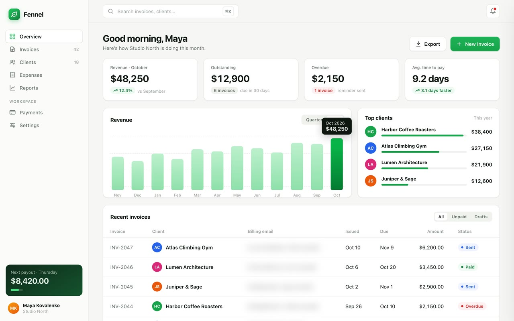</td>
    <td>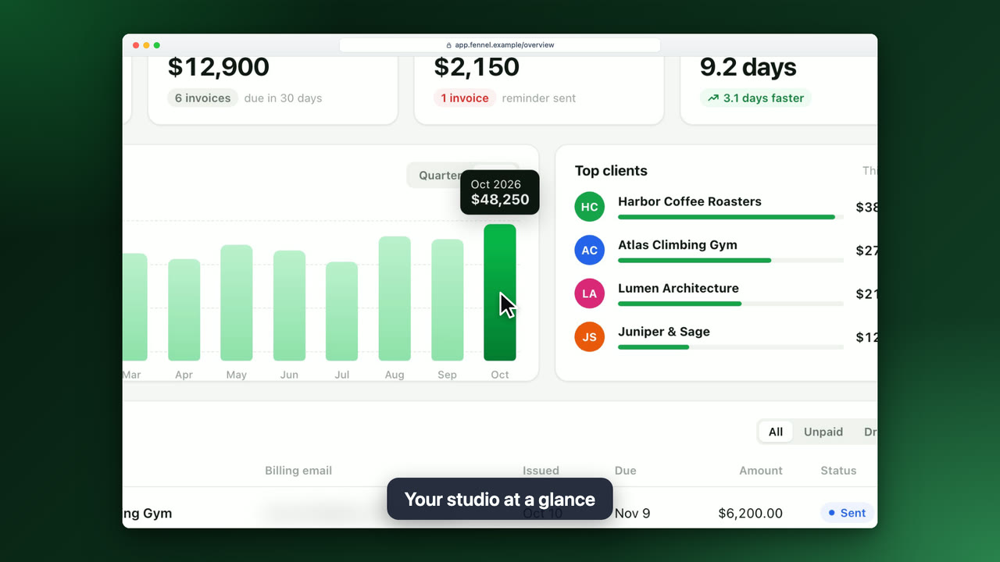</td>
  </tr>
</table>

The window, the camera move, the cursor and the caption are all added **after** the recording.
Change a caption, the colours or the pacing and re-render in seconds, without touching the app
again.

## Features

<table>
  <tr>
    <td width="50%" valign="top">
      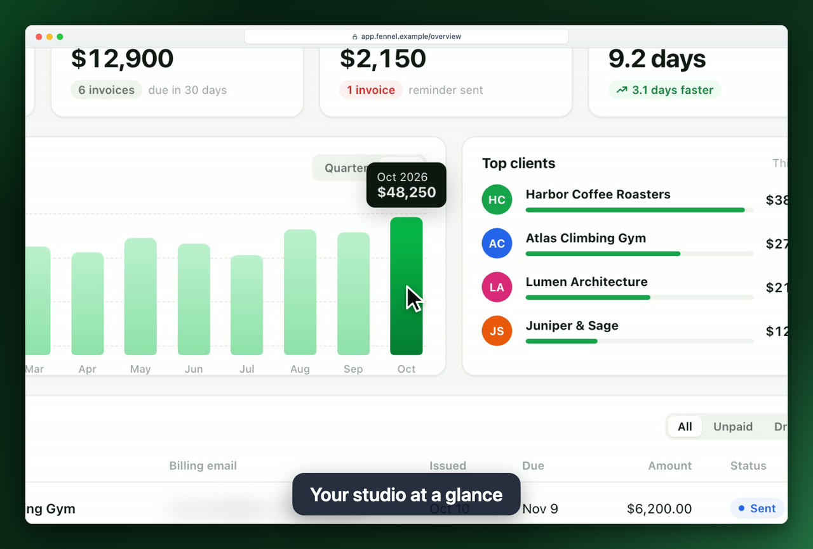<br />
      <b>🔍 Auto-zoom that follows the action</b><br />
      <sub>The camera eases in on every click and keystroke. Zoom depth comes from the target's size, and nearby moments are joined by a pan instead of a bounce.</sub>
    </td>
    <td width="50%" valign="top">
      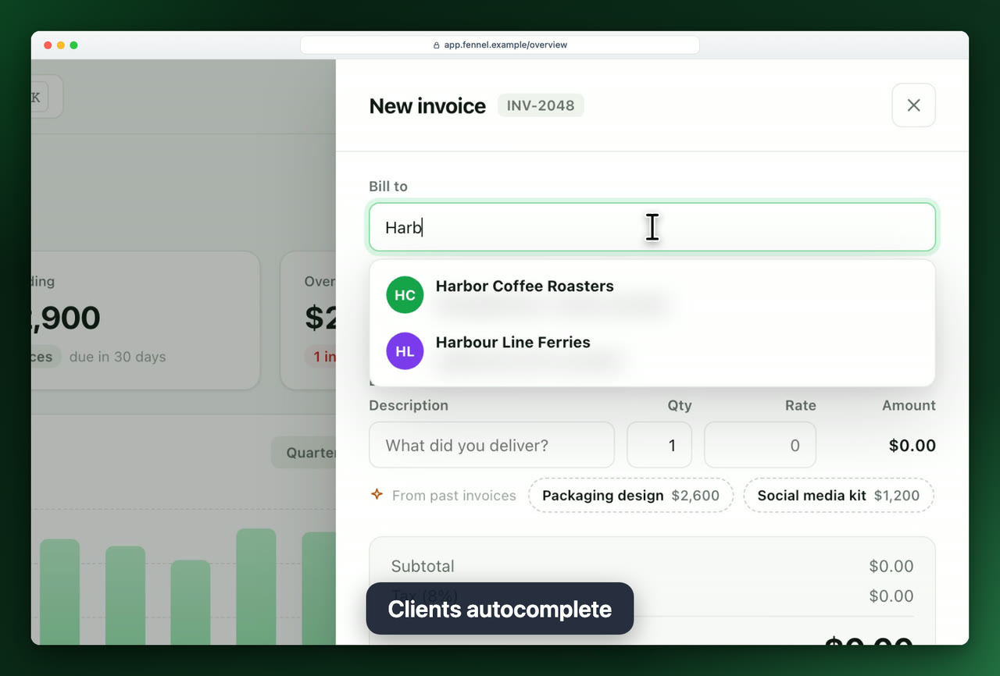<br />
      <b>⌨️ Human typing, smooth cursor</b><br />
      <sub>A synthetic cursor glides along eased paths, turns into an I-beam over text fields and types at a natural (seeded, repeatable) pace.</sub>
    </td>
  </tr>
  <tr>
    <td valign="top">
      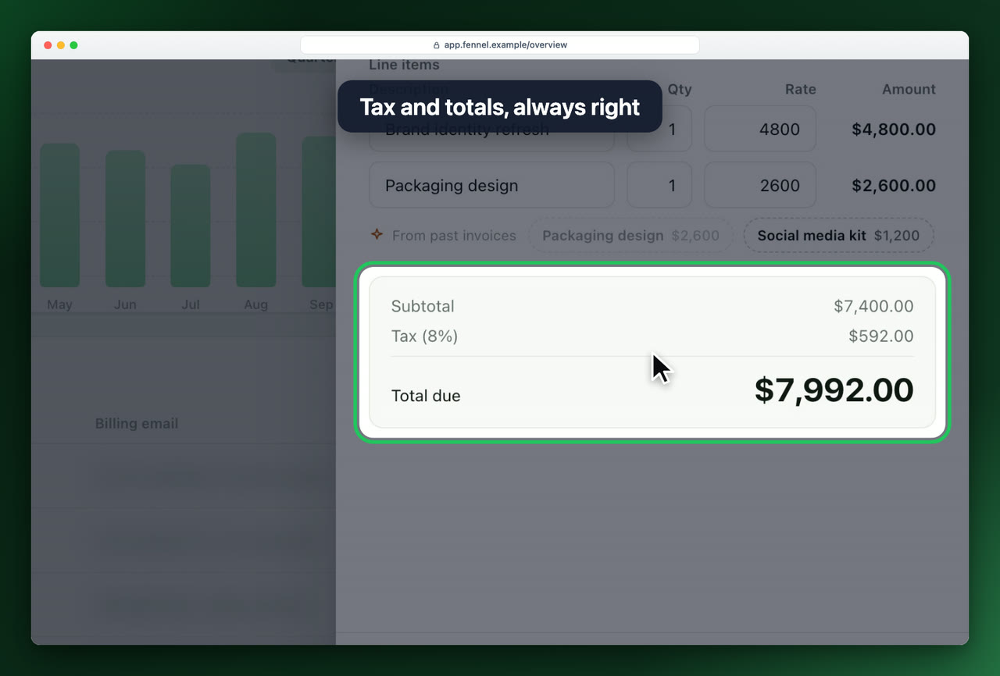<br />
      <b>🔦 Spotlights and captions</b><br />
      <sub>Dim everything except the number that matters. One-line captions carry the story and fade in sync with the action.</sub>
    </td>
    <td valign="top">
      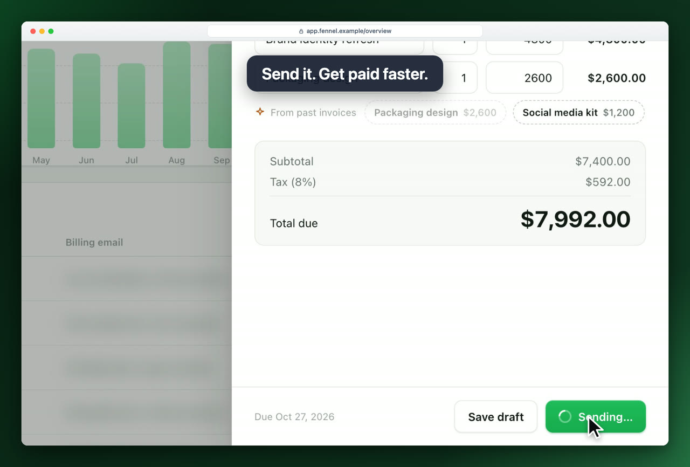<br />
      <b>⏩ Loading, compressed</b><br />
      <sub>Spinners and network waits are detected and sped up 2–8×, so the demo never stalls. Click ripples show every press.</sub>
    </td>
  </tr>
  <tr>
    <td valign="top">
      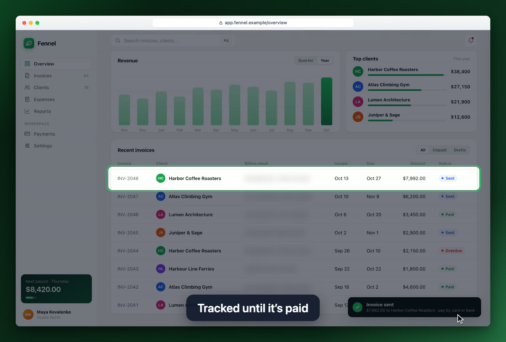<br />
      <b>🙈 Privacy masks</b><br />
      <sub>Blur emails, names or card numbers with plain CSS selectors. The blur is applied inside the browser, so no frame ever holds the real data.</sub>
    </td>
    <td valign="top">
      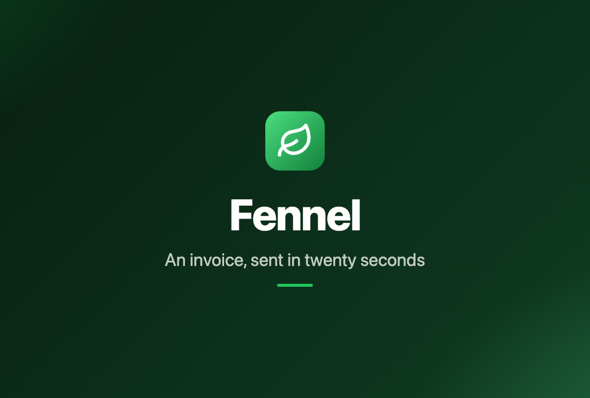<br />
      <b>🎬 Intro card and window chrome</b><br />
      <sub>Title card with your logo, a browser frame with your URL, a gradient backdrop, rounded corners and a shadow. Each of them is a <code>style</code> or <code>meta</code> field.</sub>
    </td>
  </tr>
  <tr>
    <td valign="top">
<pre lang="json">
"show": { "say": "Send it before lunch." }

"audio": {
  "voice": { "engine": "openai", "name": "nova" },
  "music": { "file": "bed.mp3" },
  "sounds": true,
  "subtitles": "burn"
}
</pre>
      <b>🎙️ Narration, music and clicks</b><br />
      <sub>Give a step a line and a voice reads it: the built-in voice of macOS or Linux, OpenAI, ElevenLabs or any TTS command. The video holds the frame until the line ends, music ducks under the voice, and subtitles come as an <code>.srt</code> or burned in.</sub>
    </td>
    <td valign="top">
      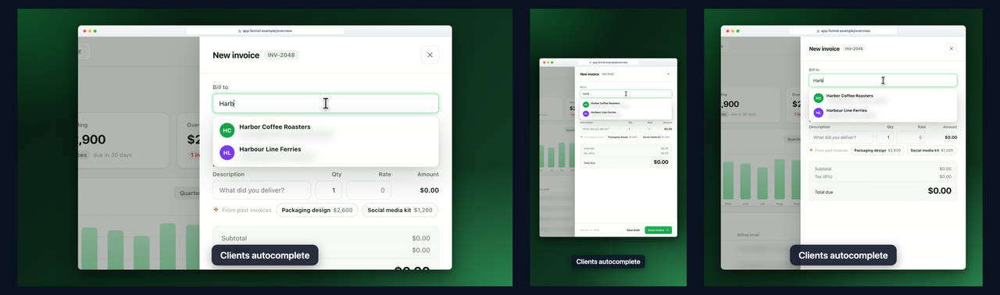<br />
      <b>📱 Every format from one take</b><br />
      <sub><code>--aspect 9:16</code> or <code>1:1</code> crops the window and a follow camera keeps the action in view. <code>--format gif</code> or <code>webp</code> for READMEs and docs. Nothing is re-recorded.</sub>
    </td>
  </tr>
  <tr>
    <td valign="top">
      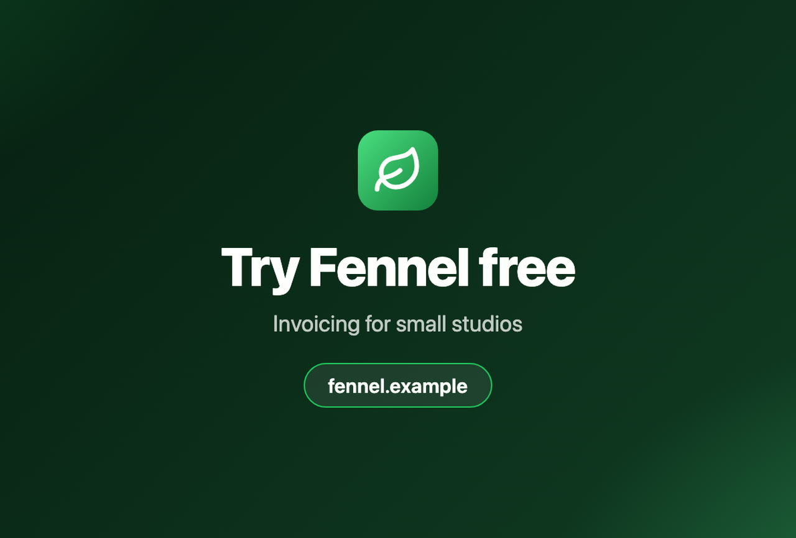<br />
      <b>📣 Ends on your call to action</b><br />
      <sub>An outro card with your logo, a headline and the URL to visit. Put it in a brand file once and every demo ends the same way.</sub>
    </td>
    <td valign="top">
      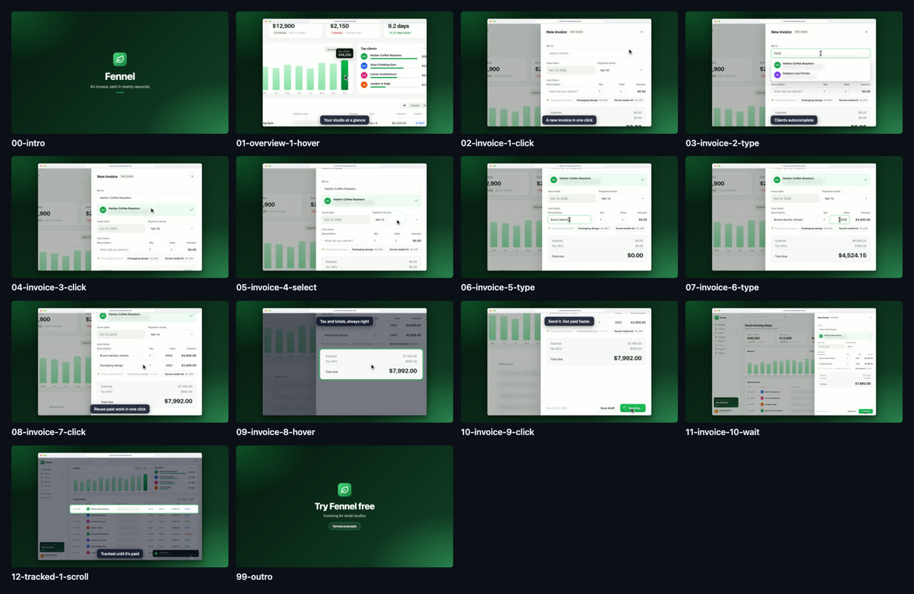<br />
      <b>🧪 Reviews its own work</b><br />
      <sub><code>showtime frames</code> renders a contact sheet of every step, and <code>showtime lint</code> flags captions that are too long or too brief to read. The agent fixes them before you look.</sub>
    </td>
  </tr>
</table>

And under the hood:

- ✅ **Rehearsal mode.** `showtime check` runs the script at full speed and screenshots every step.
  When a step fails it prints an ARIA snapshot of the page, so Claude can fix its own selectors.
- 🔁 **Stale-take detection.** The take stores a hash of the actions. Edit a caption and `render`
  reuses the take. Edit a click and `render` tells you to `record` again.
- 🧹 **Clean state for every take.** `hooks` run a reset command or call an endpoint before and
  after each rehearsal and take, so a flow that creates data works twice in a row.
- 🎭 **Deterministic pages.** `app.mock` answers flaky or slow APIs with canned JSON, `app.clock`
  pins the date, and `app.dialogs` answers `confirm()` the way the demo needs.
- 🎨 **One brand file.** `showtime.config.json` holds your colours, logo and outro; every script
  below it inherits them.
- 🛟 **Safe re-takes.** A take that fails halfway leaves the last good one untouched.
- 🤖 **JSON everywhere.** Every command takes `--json`, so agents read results instead of parsing
  prose. Captions also move to the top on their own when the action happens at the bottom of the
  screen.
- 📐 **Typed scripts.** Point `"$schema"` at [`docs/script.schema.json`](docs/script.schema.json)
  for autocomplete and validation in your editor.
- 🖥️ **Crisp at 1080p.** The app is captured at 2× device scale, so zoomed shots stay sharp.

## Try it

After [installing](#install), film the example app from the video above. The example lives in
the repo:

```bash
git clone https://github.com/mineo71/showTime.git && cd showTime
npm run example                              # terminal 1: serves examples/ on http://127.0.0.1:4800
showtime make examples/fennel/demo.json      # terminal 2: → examples/fennel/demo.mp4
```

`make` rehearses the script, records it in real time (about 25 s for this one) and renders it.
Expect a minute or two end to end.

## Use it with Claude Code or Codex

`showtime setup` links the skill into `~/.claude/skills` for Claude Code and `~/.agents/skills`
for Codex (`--agent claude` or `--agent codex` picks one). Then ask for a demo the way you would
ask a person:

> Make a 30-second demo of the checkout flow on localhost:3000 for our investor deck.
> Blur customer emails.

The agent takes it from there:

1. **Explores** the app (with the Playwright MCP if it has one) and picks the 2–4 moments that
   sell it.
2. **Writes** `demo/checkout.json`.
3. **Rehearses** with `showtime check` until every step passes, fixing selectors from the ARIA
   snapshot.
4. **Records and renders** with `showtime record` and `showtime render`.
5. **Reviews** the contact sheet from `showtime frames` and the warnings from `showtime lint`,
   tightens captions and pacing, and re-renders.

The skill ([`skill/SKILL.md`](skill/SKILL.md)) is a plain-Markdown
[Agent Skill](https://agentskills.io). Any agent that can run shell commands can follow it, and so
can a human with a text editor.

## How it works

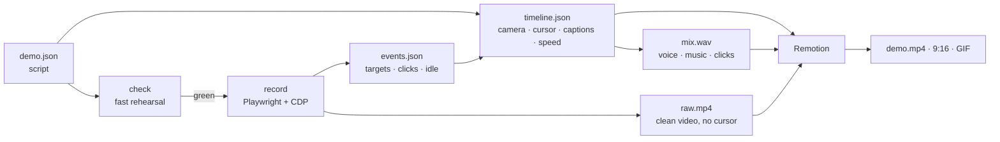

The core idea is to **separate capture from direction**. `record` drives a real Chromium through
the script and writes two things: a clean video with no cursor, and an event log of where every
target was, when each click landed and when the page sat idle. A pure function,
`buildTimeline(script, events)`, turns that log into speed segments, camera keyframes, cursor
paths, captions and spotlights, and holds the frame wherever a narration line needs more time.
The soundtrack is mixed from the same timeline, and Remotion renders the result frame by frame.

So presentation is cheap to change and recording stays honest: the app really is clicked, typed
into and waited on, and everything cinematic is computed afterwards.

## Script reference

```json
{
  "$schema": "https://raw.githubusercontent.com/mineo71/showTime/main/docs/script.schema.json",
  "version": 1,
  "meta": { "title": "Acme", "subtitle": "Reports in two clicks" },
  "app": { "url": "http://localhost:3000/", "mask": [".email"] },
  "setup": [{ "do": "click", "target": "text=Accept cookies" }],
  "style": { "accent": "#6366f1" },
  "scenes": [
    {
      "id": "report",
      "steps": [
        { "do": "click", "target": "role=button[name='New report']", "show": { "caption": "A report in one click" } },
        { "do": "type", "target": "#name", "text": "Q3 revenue" },
        { "do": "click", "target": "text=Create" },
        { "do": "wait", "for": "text=Report ready" },
        { "do": "hover", "target": ".total", "show": { "spotlight": true, "hold": 1500 } }
      ]
    }
  ]
}
```

`meta.title` adds an intro card, `meta.outro` a closing card and `meta.logo` puts your logo on
both. `setup` steps run before the camera starts (cookie banners, onboarding). Scenes group steps
for readability and for naming the stills.

<details>
<summary><b>Actions</b> (<code>do</code>)</summary>

| action   | fields                          | notes |
|----------|---------------------------------|-------|
| `goto`   | `url`                           | navigate and wait for `load` |
| `click`  | `target`                        | cursor travels there, ripple on press |
| `type`   | `target, text, pace?, clear?`   | `pace`: `human` (default), `fast` or ms per character |
| `press`  | `key`                           | `Enter`, `Escape`, `Meta+K`, … |
| `hover`  | `target`                        | |
| `select` | `target, value`                 | picks a `<select>` option by value |
| `scroll` | `target` *or* `by`              | smooth-scroll an element into view, or by pixels |
| `wait`   | `for` *or* `ms`                 | prefer `for` (a selector): the wait is sped up automatically |
| `pause`  | `ms`                            | a deliberate beat, always at 1× |

Targets are Playwright selectors: `role=button[name='Save']`, `text=Save`, `#id`,
`[data-testid=x]`, CSS, and `>>` chains.

</details>

<details>
<summary><b>Per-step presentation</b> (<code>show</code>)</summary>

| field       | value          | effect |
|-------------|----------------|--------|
| `caption`   | string         | caption while the step plays |
| `zoom`      | 1–4 or `false` | override the auto-zoom depth, or skip zooming |
| `spotlight` | boolean        | dim everything except the target |
| `hold`      | ms             | extra real time after the step (changes the take) |
| `speed`     | 0.25–16        | playback speed for this step |
| `say`       | string         | narration spoken from the start of the step; the next narrated step waits for it |

</details>

<details>
<summary><b>Look</b> (<code>style</code>)</summary>

| field        | default            | |
|--------------|--------------------|-|
| `background` | indigo gradient    | any CSS background |
| `chrome`     | `browser`          | browser window frame, or `none` |
| `address`    | the app URL        | address-bar text |
| `accent`     | `#6366f1`          | ripples, spotlight ring, intro rule |
| `padding`    | `0.06`             | backdrop around the window, as a fraction of the frame |
| `radius`     | `14`               | window corner radius, px |
| `shadow`     | `true`             | window drop shadow |
| `font`       | Inter / system UI  | captions and intro card |
| `autoZoom`   | `true`             | zoom on clicks, typing, hovers and selects |
| `autoSpeed`  | `true`             | speed up idle stretches longer than 0.8 s |
| `maxZoom`    | `1.8`              | cap for auto-zoom |

</details>

<details>
<summary><b>App</b> (<code>app</code>)</summary>

| field               | default    | |
|---------------------|------------|-|
| `url`               | (required) | where the take starts |
| `viewport`          | 1440 × 900 | CSS pixels |
| `deviceScaleFactor` | `2`        | capture resolution multiplier |
| `storageState`      | none       | Playwright storage-state file (relative to the script) to start logged in |
| `colorScheme`       | none       | `light` or `dark`; also picks the browser-bar theme |
| `locale`, `timezoneId` | none    | passed to the browser context |
| `mask`              | `[]`       | CSS selectors to blur (plain CSS, not `text=`) |
| `mock`              | `[]`       | `[{ url, method?, status?, json? \| body?, headers?, delayMs? }]`: answer matching requests (`url` is a glob like `**/api/stats*`; the first match wins) |
| `clock`             | none       | start the page clock at this ISO date-time; it then runs normally |
| `dialogs`           | `accept`   | answer `alert`/`confirm`/`prompt` with `accept` or `dismiss` |

</details>

<details>
<summary><b>Sound</b> (<code>audio</code>)</summary>

```json
"audio": {
  "voice": { "engine": "system", "name": "Samantha", "speed": 1 },
  "music": { "file": "music/bed.mp3", "volume": 0.25 },
  "sounds": true,
  "subtitles": "file"
}
```

| field                | default    | |
|----------------------|------------|-|
| `voice.engine`       | `system`   | `system` (macOS `say`, Linux `espeak-ng`), `openai`, `elevenlabs`, or `command` |
| `voice.name`         | engine default | voice name (`system`, `openai`), or voice id (`elevenlabs`, required) |
| `voice.speed`        | `1`        | 0.5–2 |
| `voice.model`        | engine default | `gpt-4o-mini-tts` (OpenAI), `eleven_multilingual_v2` (ElevenLabs) |
| `voice.instructions` | none       | OpenAI only: how to speak ("warm, confident") |
| `voice.command`      | none       | `command` only: reads the text on stdin, writes audio to `{out}` (e.g. Piper) |
| `music`              | none       | `{ file, volume? }`: a bed under the whole video, looped and ducked under the voice |
| `sounds`             | `false`    | click and keystroke sounds |
| `subtitles`          | `file`     | `file`: an `.srt` next to the video; `burn`: also on the video (captions move up); `off` |

`openai` and `elevenlabs` read `OPENAI_API_KEY` / `ELEVENLABS_API_KEY` from the environment
(`OPENAI_BASE_URL` points at any OpenAI-compatible server). Each line is synthesized once and
cached; edits to `say` or `audio` only need `render`.

</details>

<details>
<summary><b>Cards</b> (<code>meta</code>)</summary>

| field      | |
|------------|-|
| `title`, `subtitle` | intro card |
| `logo`     | SVG, PNG, JPEG or WebP (≤ 2 MB), relative to the file that names it; shown on the intro and outro |
| `outro`    | `{ title, subtitle?, url? }`: closing card after the video |

</details>

<details>
<summary><b>Hooks</b> (<code>hooks</code>)</summary>

```json
"hooks": {
  "before": [{ "run": "npm run db:reset" }],
  "after": [{ "request": { "url": "http://localhost:3000/api/test/reset", "method": "POST" } }]
}
```

`before` hooks run at the start of every `check` and `record` (so `make` resets between the
rehearsal and the take); `after` hooks run when they end, even after a failure, and a failing
`after` hook is a warning that never costs you the take. `run` is a shell
command in the script's folder (120 s timeout); `request` is an HTTP call that must answer 2xx.

</details>

<details>
<summary><b>Brand file</b> (<code>showtime.config.json</code>)</summary>

Put it next to your scripts or in any folder above them; the nearest one applies. Its `style`,
`meta` and `audio` are defaults, and a script's own fields win key by key.

```json
{
  "style": { "background": "linear-gradient(135deg, #0f172a, #312e81)", "accent": "#6366f1", "address": "app.acme.com" },
  "meta": { "logo": "brand/logo.svg", "outro": { "title": "Try Acme free", "url": "acme.com" } }
}
```

</details>

## CLI

| command | what it does |
|---|---|
| `showtime setup [--agent claude\|codex\|all] [--no-browsers]` | download the browsers, link the skill |
| `showtime make <script> [render options]` | check → record → render |
| `showtime check <script> [--json] [--headed]` | rehearse; a screenshot per step; the first failure with an ARIA snapshot |
| `showtime record <script> [--headed] [--keep-frames]` | record a take into `.showtime/<name>/take` |
| `showtime render <script> [-o out] [--aspect 16:9\|9:16\|1:1] [--format mp4\|gif\|webp] [--width px] [--no-audio]` | render from the last take, without re-recording |
| `showtime frames <script> [--aspect …]` | QA stills (intro, one per step, outro) and a contact sheet of them |
| `showtime lint <script>` | warnings about captions, pauses and length; timing checks need a take |
| `showtime schema` | print the script's JSON Schema |

Every command takes `--json` and then prints exactly one JSON document. The video lands next to
the script (`demo/pitch.json` → `demo/pitch.mp4`, `demo/pitch-9x16.mp4`, `demo/pitch.gif`), with
`demo/pitch.srt` when it is narrated. Working files live in
`.showtime/<name>/`, which is worth adding to your `.gitignore`.

## Tips for a great demo

- **One idea per caption, six words at most.** Caption the benefit ("Paid in two clicks"), not
  the click ("Click Pay").
- **Let payoffs breathe.** After the screen that matters, add `hold` (800–2000 ms) and a
  `spotlight` on the one number that sells it.
- **Never `pause` for loading.** Use `wait` with a selector and auto-speed compresses the spinner.
- **Start clean.** Use `setup` for cookie banners, `app.storageState` to skip the login, `app.mask`
  for anything personal, and `hooks` to reset the data between `check` and `record`.
- **Pin the world.** Mock slow or random APIs with `app.mock` and pin the date with `app.clock`,
  so every take looks the same.
- **Narrate the why, not the clicks.** One short sentence per moment. If `showtime lint` says a
  line holds the frame for seconds, shorten it or give the step more to show.

## FAQ

**Which apps does it work with?** Any web app Chromium can open: a localhost dev server, staging
or production. Logged-in flows work through `app.storageState`.

**Does showTime call an AI model?** Not for directing: the AI part (writing, fixing and reviewing
the script) happens in your agent, guided by the skill. Narration is text-to-speech. The built-in
voice of macOS or Linux needs no key and nothing leaves your machine; with `openai` or
`elevenlabs`, only the narration text is sent to that provider, with your key from the
environment.

**Why not just screen-record?** You can, once. A screen recording can't be re-edited when the copy
changes, the cursor is wherever your hand was, and the spinner plays at full length. With
showTime, edits are a re-render and a UI change is one command.

**Does it run on Linux or Windows?** It is developed on macOS. Linux should work since it only
needs Playwright and ffmpeg. Windows is untested.

## Roadmap

- 🧑‍🎨 `showtime studio`: a local page with a live player and a timeline to drag captions, zooms and
  speed, saving back to the JSON.
- 🎥 `showtime record-human <url>`: click through the app yourself and get a script back.
- 🎞️ Deterministic frame-by-frame capture in virtual time, for a perfect 60 fps.
- 🧩 An MCP server for Claude Desktop, and a desktop studio for timeline tweaks.
- 📲 Mobile (iOS Simulator) and desktop-app drivers that produce the same `events.json`.

## Development

```bash
npm test             # unit tests (seconds)
npm run test:int     # Playwright + ffmpeg + Remotion, end to end (minutes)
npm run typecheck
npm run media        # rebuild the README media from examples/fennel (see CONTRIBUTING)
```

See [CONTRIBUTING.md](CONTRIBUTING.md) for the architecture and how to work on it. The design
document is in [`docs/superpowers/specs`](docs/superpowers/specs/2026-10-13-showtime-design.md).

## License

[MIT](LICENSE) © 2026 Oleh Rylskyj.

showTime renders with [Remotion](https://www.remotion.dev), which has its own
[license](https://www.remotion.dev/license): it is free for individuals, non-profits and companies
of up to 3 people, and larger companies need a Remotion company license. The renderer only reads
`timeline.json`, so it can be swapped out.

<sub>Fennel, the app in the example, is fictional. It was built for this README and its data is made up.</sub>
